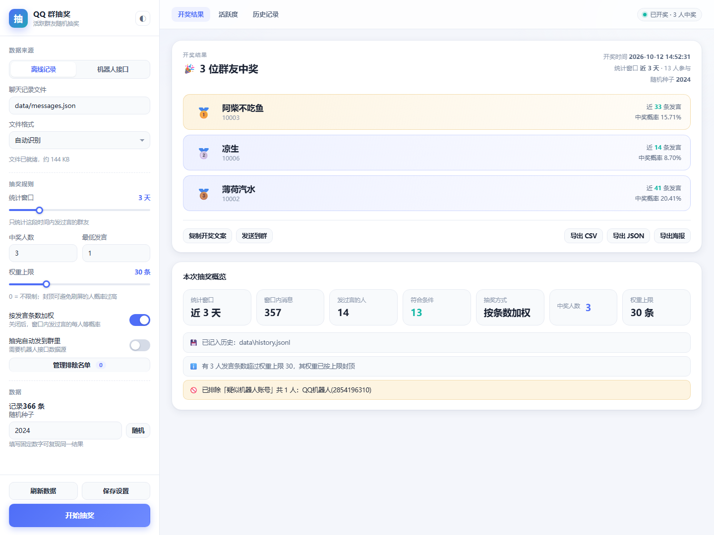
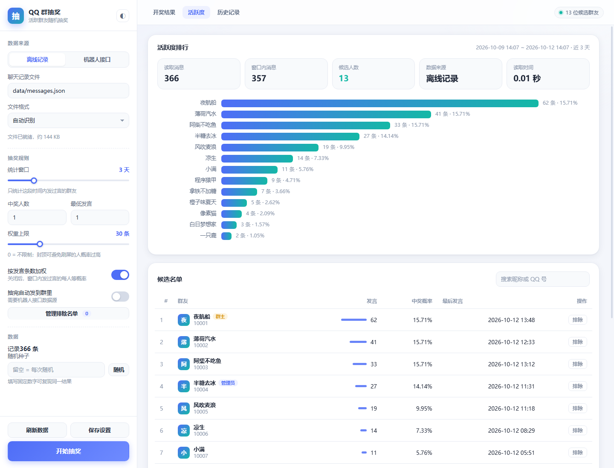
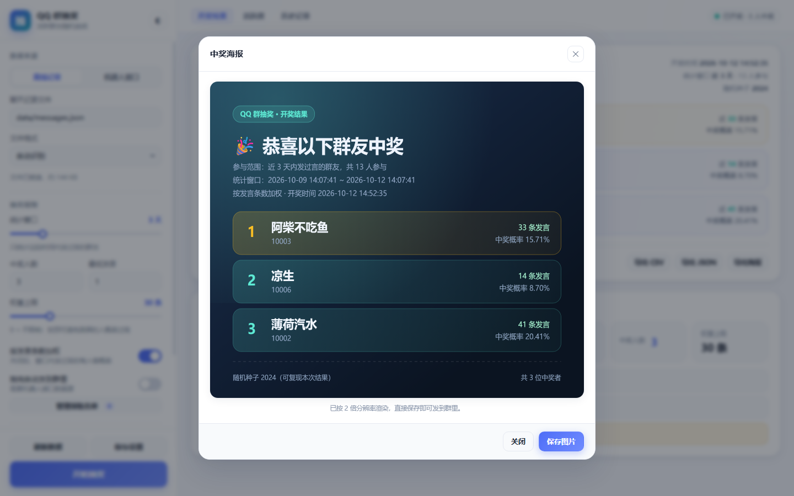
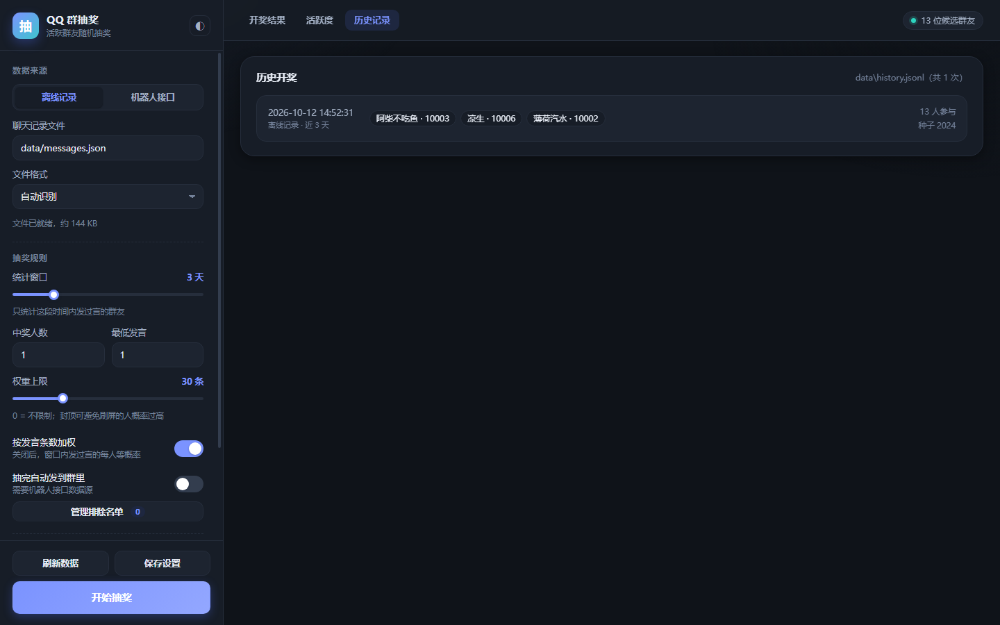
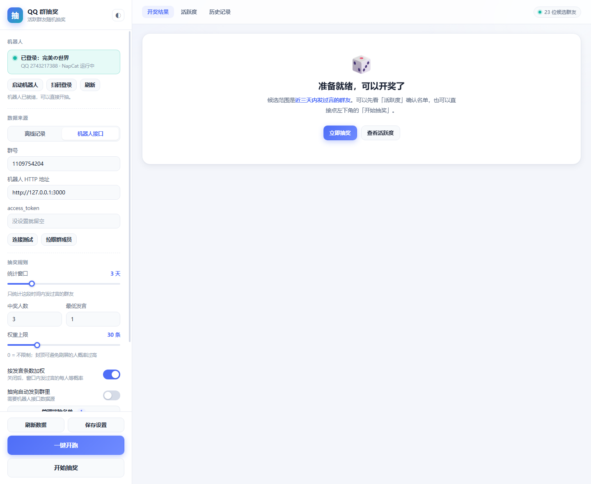

# QQ 群抽奖工具

在**近期三天内发过言的活跃群友**范围内随机抽奖的群内抽奖工具。带图形界面，也保留命令行。

- **候选范围**：只统计最近 N 天（默认 3 天）有发言的群友，潜水的人自动不在池子里
- **中奖概率**：默认按发言条数加权（话越多概率越高），可切换为每人等概率
- **一次抽多人**：支持一次抽 1~N 人，自动去重，同一人不会重复中奖
- **黑名单 / 白名单**：可永久排除指定 QQ 号、机器人、群主或管理员
- **两种数据来源**：机器人接口实时拉取，或解析离线导出的聊天记录
- **图形界面**：双击 `启动界面.bat` 弹出独立窗口，可预览活跃度、一键开奖、导出中奖海报
- **纯 Python 标准库**：无需 pip 安装任何依赖，Python 3.8+ 直接跑
- **不装任何东西也能用**：仓库自带的演示数据开箱即跑，不用先配机器人

---

## 0. 拿到手就能跑（60 秒）

### 方式一：免安装绿色包（推荐）

到 [Releases](https://github.com/Xie1Yuhe/qq-group-lottery/releases) 下载
**`qq-group-lottery-portable-win-x64.zip`**，解压后按里面的 `使用说明.txt` 操作即可
（自带 Python 运行时，什么都不用装）。

### 方式二：源码 + 自己的 Python

需要 **Python 3.8 或更高**（[python.org](https://www.python.org/downloads/) 下载时记得勾
`Add python.exe to PATH`）。然后：

```powershell
# 1. 看看谁是活跃群友（用仓库自带的演示数据，366 条假消息 / 17 个假账号）
python run_lottery.py stats --top 20

# 2. 抽 3 个人，固定种子，结果可复现
python run_lottery.py draw -n 3 --seed 2024
```

> 默认 `config.json` 里 `source` 是 `file`、指向 `data/messages.json`（演示数据），
> 所以上面两条命令不需要任何额外准备。想接真实群，见 [第 4 节](#4-两个关键数据来源)。

### 方式三：图形界面

双击 **`启动界面.bat`**（或 `python app.py`），弹出独立窗口：

| 开奖结果 | 活跃度排行 |
|---|---|
|  |  |

| 中奖海报（可保存为图片） | 历史记录 · 深色主题 |
|---|---|
|  |  |

详细的界面用法见 **[docs/使用说明.md](docs/使用说明.md)**。

> 🔒 **关于隐私**：本仓库里的群号、被拉黑的 QQ 号、以及文档中的登录账号示例，**全部是占位假值**；
> 作者真实的群号 / QQ 号 / 昵称、真实的开奖记录与消息存档都没有上传。
> 详见 [第 8 节](#8-关于本仓库的分发范围)。

---

## 1. 图形界面（推荐）

双击 **`启动界面.bat`**，会弹出一个没有地址栏、没有标签页的独立窗口（Edge 的「应用窗口」模式），
看起来就是一个普通的桌面程序。也可以命令行启动：

```powershell
python app.py                 # 默认用独立窗口打开
python app.py --tab           # 改用普通浏览器标签页
python app.py --port 9000     # 换端口
python app.py --no-open       # 只起服务，不打开窗口
```

界面长这样（截图均来自本机真实运行）：

| 开奖结果 | 活跃度排行 |
|---|---|
|  |  |

| 中奖海报（可保存为图片） | 历史记录 · 深色主题 |
|---|---|
|  |  |

机器人管理面板（左侧顶部）：显示登录状态、一键启动、扫码登录、一键开跑



界面能做的事：

| 功能 | 说明 |
|---|---|
| **机器人管理** | 面板里显示「未安装 / 未运行 / 未登录 / 已登录：昵称」，一键**启动机器人**、**扫码登录**、刷新状态；登录状态每 3 秒自动轮询 |
| **扫码登录** | 点「扫码登录」弹出二维码，手机 QQ 扫一下即可；登录成功后界面自动切换到「已登录」并提示 |
| **一键开跑** | 底部的橙色主按钮：自动选人最多的群 → 保存设置 → 拉取消息 → 统计 → 开奖，全程显示每一步的执行结果，**不会往群里发任何消息** |
| **消息存档** | 左侧面板显示库内条数、历史跨度、同步间隔；可「立即同步」；每 5 分钟自动增量落盘，历史不再被机器人缓存挤掉 |
| 数据源配置 | 顶部切换「离线记录 / 机器人接口」，填文件路径或群号 + HTTP 地址，可一键**连接测试** |
| 抽奖群选择 | 机器人登录后自动列出它加入的群（按人数排序），下拉直接选，自动填进群号 |
| **抽奖范围** | 顶部二选一：**活跃群友**（按发言加权）/ **全群成员**（每人等概率）。切换时会自动保存，并收放对应参数 |
| 活跃度预览 | 指标卡 + 横向条形图 + 候选表格，直接看到谁在窗口内发过言、发言多少、中奖概率多少 |
| 参数调节 | 统计窗口、中奖人数、最低发言、权重上限滑杆、加权开关，改完点「保存设置」写回 `config.json` |
| 排除名单 | 弹窗管理黑名单/白名单，可一键从候选表格或群成员列表里点选加入，也可勾选排除群主、管理员 |
| 开奖动画 | 点「开始抽奖」（或按 <kbd>空格</kbd>）滚动抽取，中奖卡片逐张揭晓，🥇🥈🥉 标注名次 |
| 导出 | 一键导出 CSV、JSON，或生成**中奖海报**（2 倍分辨率 PNG，直接发群） |
| 复制文案 | 生成一段适合发群的「开奖文案」，一键复制 |
| 发送到群 | **唯一会往真实群发消息的动作，必须你自己点**。测试环境下这个按钮会被安全锁禁用 |
| 历史记录 | 回看历次开奖的中奖名单、参与人数与随机种子 |
| 深色主题 | 右上角 ◐ 切换，选择会记住 |

小细节：中奖结果会带**随机种子**，把种子填回侧栏就能复现同一份名单；数据源或参数改动后，
界面会提示重新统计，不会拿旧数据开奖。

---

## 2. 命令行

仓库里已经带了一份演示用的假聊天记录（`data/messages.json`，366 条消息、17 个账号），
所以下面两条命令可以**直接跑**，不需要任何额外准备：

```powershell
# 看活跃度预览：谁在这三天里发过言、发了多少条、谁被排除了
python run_lottery.py stats --top 20

# 正式抽奖：抽 3 人，用固定种子（结果可复现）
python run_lottery.py draw -n 3 --seed 2024
```

想看纯文本输出长什么样，直接打开 [示例输出.txt](示例输出.txt)。
演示数据可以随时重新生成，也可以换成你自己的记录（直接覆盖 `data/messages.json` 即可）：

```powershell
python scripts/make_demo_data.py
```

Windows 上还可以用封装好的启动器（会自动寻找可用的 Python）：

```powershell
lottery.bat draw -n 3                       # 批处理入口
Set-ExecutionPolicy -Scope Process -ExecutionPolicy Bypass
.\抽奖.ps1 draw -n 3                        # PowerShell 入口
```

把群号、数据来源等参数写进 `config.json` 后，命令就能简化成一条（界面与命令行共用这份配置）：

```powershell
python run_lottery.py draw
```

---

## 3. 目录结构

```
QQ群抽奖/
├─ 启动界面.bat                双击启动图形界面
├─ app.py                      图形界面启动器（本地服务 + Edge 独立窗口）
├─ webapp/                     界面本体（HTML / CSS / JS，无外部依赖）
│  ├─ index.html
│  └─ assets/style.css, app.js
├─ config.json                 主配置文件（JSON 里用 "_说明_xxx" 当注释）
├─ run_lottery.py              命令行统一入口
├─ lottery.bat / 抽奖.ps1      Windows 命令行启动器
├─ qq_lottery/                 程序包
│  ├─ cli.py                   命令行解析与三个子命令
│  ├─ config.py                配置加载、校验、时间窗口解析
│  ├─ model.py                 数据模型（消息、活跃度、中奖者）
│  ├─ sources.py               数据来源：文件解析 + OneBot 接口
│  ├─ lottery.py               活跃度统计、筛选、加权抽取
│  ├─ archive.py               消息存档（SQLite 增量累积历史）
│  ├─ watch.py                 无界面常驻：持续攒历史（开机自启）
│  ├─ report.py                控制台 / JSON / CSV / 群消息文案
│  ├─ service.py               界面后端业务层（抽奖内核 → 接口）
│  ├─ settings.py              config.json 读写与校验
│  ├─ webapp.py                本地 HTTP 服务（仅监听 127.0.0.1）
│  └─ paths.py                 路径基准：一切相对程序目录
├─ scripts/
│  ├─ make_demo_data.py        生成演示数据
│  ├─ convert_nt_db.py         把「已解密的 QQ NT 消息库」转成本工具可读的数据
│  ├─ make_icon.py             从素材生成图标（多尺寸 .ico + 页面 png）
│  ├─ set_icon.py              给快捷方式设置图标
│  ├─ napcat_check.ps1         机器人接口连通性诊断（装完 NapCat 后跑它）
│  ├─ archive-watch.bat        无界面常驻同步的启动脚本（开机自启项）
│  ├─ archivetest.py           60 项消息存档、常驻与性能专项自检
│  ├─ selftest.py              142 项命令行端到端自检
│  ├─ uitest.py                198 项界面后端 + 前端静态 + 转换器 + 安全锁 + 文档护栏自检
│  └─ screenshot.py            无头浏览器截图（开发辅助）
├─ maintenance/                系统权限档案（与抽奖无关；本仓库未收录该目录）
├─ 示例输出.txt                一次真实运行的完整文本输出
├─ docs/                       文档与截图
│  ├─ NapCat配置指南.md        从零装 NapCat 并接进本工具的完整步骤
│  └─ ui-*.png                 界面截图（README 里引用）
└─ data/
   ├─ messages.json            当前使用的聊天记录（默认演示数据，可覆盖）
   ├─ sample_messages.*        四种格式的演示样例
   └─ history.jsonl            历史抽奖记录（首次开奖后生成）
```

程序运行时还会自动产生下面这些目录和缓存，都不影响使用，也可以随时删除：

| 目录 | 说明 |
|---|---|
| `out/` | 导出 CSV / JSON / 中奖海报的默认位置，第一次导出时自动创建 |
| `.browser-profile/` | 界面窗口（Edge 应用模式）的独立临时配置，删掉后下次启动会重建 |
| `qq_lottery/__pycache__/` | Python 字节码缓存，`.gitignore` 已忽略 |
| `data/archive.db` | 消息存档（SQLite），含群成员 QQ 号，`.gitignore` 已排除 |
| `data/history.jsonl` | 历史开奖记录，含中奖者 QQ 号，`.gitignore` 已排除 |

> **隐私提醒**：`config.json` 里不要填真实群号后直接提交；本仓库里的群号、黑名单 QQ 号
> 以及文档中的账号示例都已是占位值，真实数据不会随仓库分发。

---

## 4. 两个关键数据来源

### 4.1 机器人接口（推荐，可在群内自动开奖）

适用于 NapCat、Lagrange、go-cqhttp、LLOneBot 等实现了 **OneBot v11** 的机器人，
只要它们开启了 HTTP 服务端（默认 `http://127.0.0.1:3000`）。

`config.json` 里改成：

```json
{
  "source": "onebot",
  "group_id": "你的群号",
  "days": 3,
  "winners": 1,
  "post_to_group": true,
  "onebot": {
    "base_url": "http://127.0.0.1:3000",
    "access_token": "你的token，没设置就留空"
  }
}
```

然后直接开奖并把结果发到群里：

```powershell
python run_lottery.py draw --post
```

工具会调用这些接口：`get_group_msg_history`（向前翻页取最近消息）、
`get_login_info`（识别并排除机器人自己）、`send_group_msg`（发布开奖结果）。

> 📖 **还没装 NapCat？** 看 [docs/NapCat配置指南.md](docs/NapCat配置指南.md)——从下载、扫码登录、
> 开 HTTP 服务端到接进本工具的完整步骤，附排错对照表。
> 装完用 `.\scripts\napcat_check.ps1 -Group 你的群号` 一键诊断，它会自动找出端口和 token
> 并真实调用一次 `get_group_msg_history` 验证。

只拉取不抽奖、把消息存成文件留档：

```powershell
python run_lottery.py fetch --source onebot -o data/messages.json          # 存成 JSON 数组
python run_lottery.py fetch --source onebot -o data/messages.jsonl --jsonl # 大数据量建议 JSONL
```

拉取下来之后，就能用文件模式离线复算同一场抽奖：

```powershell
python run_lottery.py draw --source file --file data/messages.json --seed 2024
```

### 4.2 离线聊天记录文件

不想开机器人时，把群消息导出成文件再离线抽奖。支持四种格式，`format` 设为 `auto` 会自动识别：

| 格式 | 说明 |
|---|---|
| `json` | OneBot `get_group_msg_history` 的原始返回、消息对象数组、或带 `messages`/`data` 包裹层的任意结构 |
| `jsonl` | 每行一个 JSON 对象，适合几十万条的大记录 |
| `csv` | 需带表头，列名包含 `user_id`/`qq`、`time`/`timestamp`、`nickname` 等（列名大小写和分隔符都兼容） |
| `text` | QQ 客户端导出的文本记录，形如 `12:30:45 张三(12345678): 晚上好`，日期行写成 `===== 2024-05-20 =====` |

```powershell
python run_lottery.py draw --source file --file D:\导出\群消息.txt
python run_lottery.py draw --source file --file D:\导出\群消息.csv --format csv
```

四种格式的样例都在 `data/sample_messages.*`，可以直接拿来对照格式：

```powershell
python run_lottery.py draw --source file --file data/sample_messages.txt -n 2
python run_lottery.py draw --source file --file data/sample_messages.csv -n 2
```

> 文本记录若是 GBK 编码，工具会自动转码读取，无需手工处理。

### 4.3 怎么把群聊天记录导出来

这一步能不能成，取决于你的 QQ 版本，先把三条路的实际情况说清楚：

| 路径 | 可行性 | 说明 |
|---|---|---|
| **NapCat 等 OneBot 实现** | ⭐ 推荐 | 不用导出，接口直接拉历史消息。见 [4.1](#41-机器人接口推荐可在群内自动开奖) |
| 老版 QQ「消息管理器 → 导出消息记录」 | 老版 QQ 可用 | 产出 `.txt`（可直接用）或 `.bak`（见下） |
| QQ NT（9.9.x）自带的导出 | ❌ 没有 | NT 版已移除消息管理器与导入/导出入口 |
| 直接读 `nt_msg.db` | 需先解密 | 库里确实有全部记录，但被腾讯加密（表头为 `SQLite header 3`），本工具不提供解密 |

**关于 `.bak` 文件**：它是老版 QQ 的私有打包格式（本质是个 ZIP，里面是加密的库副本与内容块），
**唯一官方用法是导回 QQ 让它解密**，而 QQ NT 已经没有导入入口——所以 `.bak` 在新版 QQ 上是一条死路，
无论用什么工具都无法直接读出文本。

**如果你通过其他途径拿到了已解密的库**（`nt_msg.db` 变成标准 SQLite 之后），用本工具的转换器：
```powershell
# 先看库里有哪些会话、各有多少消息、时间范围
python scripts/convert_nt_db.py --db-dir "D:\解密后的目录" --list

# 导出某个群（自动解析消息体并只保留有文本的消息）
python scripts/convert_nt_db.py --db-dir "D:\解密后的目录" --group 123456789 -o data/messages.json

# 也可以只取最近 7 天，并额外输出 JSONL
python scripts/convert_nt_db.py --db-dir "D:\解密后的目录" --group 123456789 --days 7 `
    -o data/messages.json --jsonl data/messages.jsonl
```

转换出的文件与「离线记录」数据源完全兼容，接下来照常用即可：

```powershell
python run_lottery.py stats --source file --file data/messages.json --top 30
python run_lottery.py draw  --source file --file data/messages.json -n 3
```

> 转换器**不含任何解密功能**，只读已经解密的明文库；遇到仍是 `SQLite header 3` 的加密库，
> 它会明确提示「需要先自行解密」而不是报一堆看不懂的错。

---

## 5. 抽奖规则配置

`config.json` 完整字段：

| 字段 | 默认值 | 说明 |
|---|---|---|
| `source` | `file` | 数据来源：`onebot` 或 `file` |
| `group_id` | `""` | 群号，`source` 为 `onebot` 时必填 |
| `days` | `3` | 统计窗口天数（`window_mode` 为 `days` 时生效） |
| `window_mode` | `auto` | `auto` = 自动适配到缓存能完整覆盖的时段（推荐）；`days` = 按指定天数 |
| `archive.enabled` | `true` | 是否启用本地消息存档 |
| `archive.path` | `data/archive.db` | 存档数据库位置 |
| `archive.sync_interval_seconds` | `300` | 自动同步间隔（秒） |
| `archive.auto_sync` | `true` | 是否按间隔自动同步 |
| `pool` | `active` | 抽奖范围：`active` = 活跃群友（按发言加权）；`all_members` = 全群成员（每人等概率） |
| `winners` | `1` | 一次抽几人（去重，不重复中奖） |
| `weighting` | `true` | `true` 按发言条数加权；`false` 每人等概率 |
| `weight_cap` | `0` | 单人权重上限（条数）。**默认 0 = 不限制**；担心有人刷屏时再设 20~500 封顶 |
| `min_messages` | `1` | 最低发言条数门槛 |
| `exclude_roles` | `[]` | 按身份排除，可填 `owner`（群主）、`admin`（管理员） |
| `blacklist` | `[]` | 黑名单 QQ 号，永不参与 |
| `whitelist` | `[]` | 白名单，非空时只有名单内的人能参与（仍需近 N 天有发言） |
| `seed` | `null` | 固定随机种子可复现结果；`null` 为每次真随机 |
| `post_to_group` | `false` | 抽完自动把开奖文案发到群里 |
| `history_file` | `data/history.jsonl` | 每次结果追加保存，留档备查 |
| `file.path` | `data/messages.json` | 离线记录文件路径 |
| `file.format` | `auto` | `auto` / `json` / `csv` / `text` |
| `onebot.base_url` | `http://127.0.0.1:3000` | 机器人 HTTP 地址 |
| `onebot.access_token` | `""` | 接口鉴权 token |
| `onebot.fetch_limit` | `30000` | 最多拉取条数，防止翻页过久 |
| `onebot.page_size` | `200` | 每页拉取条数 |
| `onebot.max_pages` | `300` | 最多翻页次数 |
| `onebot.exclude_self` | `true` | 排除机器人自己发的消息 |

### 概率是怎么算的

- **加权模式**：某人的权重 = 他在窗口内的发言条数（受 `weight_cap` 封顶），
  中奖概率 = 本人权重 ÷ 当前池子总权重。
- **等概率模式**：所有候选人的权重都是 1，每人机会相同。
- **抽多人**：抽出第一个人后，他从池子里移除再抽下一个，
  所以报告中显示的「第 N 轮中奖概率」是当轮的条件概率，分母逐轮变小。

---

## 6. 命令参考

```
python run_lottery.py draw   [参数]   执行抽奖（默认行为）
python run_lottery.py stats  [参数]   只看活跃度统计，不抽奖
python run_lottery.py fetch  [参数]   从机器人拉取消息并保存为文件
python run_lottery.py watch  [参数]   无界面常驻，持续把消息存入本地存档
```

常用参数：

| 参数 | 说明 |
|---|---|
| `-c, --config 路径` | 指定配置文件（默认读工作目录下的 `config.json`） |
| `-s, --source` | `file` 或 `onebot` |
| `-g, --group` | 群号 |
| `-d, --days` | 统计窗口，如 `3`、`3d`、`72h`、`30m` |
| `--file` / `--format` | 离线记录路径与格式 |
| `-n, --winners N` | 抽取人数 |
| `--seed N` | 固定随机种子，结果可复现 |
| `--no-weight` | 切换为每人等概率 |
| `--weight-cap N` | 单人权重上限 |
| `--min-messages N` | 最低发言条数 |
| `--blacklist 1,2,3` | 追加黑名单（逗号分隔，会与配置文件合并） |
| `--exclude-role owner,admin` | 追加排除身份 |
| `--onebot-url` / `--access-token` | 覆盖机器人连接信息 |
| `--json [文件]` | 输出机器可读的 JSON 结果（不带文件名则打印到屏幕） |
| `--csv 文件` | 导出中奖名单 CSV |
| `--history [文件]` / `--no-history` | 指定或关闭历史记录 |
| `--post` | 把开奖文案发送到群里 |
| `-q, --quiet` | 只输出结果行，方便脚本调用 |
| `--top N` | 控制台展示活跃度排行前 N 名 |

### 常驻机器人的做法

想让群友在群里发指令就开奖，把这条命令挂到机器人的指令处理里即可（示例）：

```powershell
python run_lottery.py draw --source onebot --group 123456789 -n 1 --post -q
```

配合 Windows 计划任务，还可以做成每周固定时间自动开奖。

---

## 7. 常见场景

```powershell
# 抽 3 人，排除群主和管理员，并把机器人自己排除在外
python run_lottery.py draw -n 3 --exclude-role owner,admin --post

# 只看最近 24 小时发言的人，每人等概率
python run_lottery.py draw --days 24h --no-weight

# 抑制刷屏：发言超过 20 条的人最多按 20 条算概率
python run_lottery.py draw --weight-cap 20

# 抽奖前先核对候选名单和排除原因
python run_lottery.py stats --days 3 --top 30

# 结果留档：CSV 给群友看，JSON 自己存档
python run_lottery.py draw -n 5 --csv out/中奖名单.csv --json out/result.json
```

---

## 8. 自检与示例输出

```powershell
python scripts/selftest.py     # 命令行：142 项
python scripts/archivetest.py  # 消息存档 + 常驻 + 性能：60 项
python scripts/uitest.py       # 界面 + 机器人管理 + 安全锁：198 项
```

> 两套自检都在**临时目录里使用隔离的配置**，不会读写你真实的 `config.json`
> ——你的配置里可能是真实的机器人和真实群号，测试不该碰它。
> 若配置已指向真实机器人，`uitest.py` 还会额外做一次真实链路检查，
> 报告机器人在线状态与当前可拉取的历史深度。

- `selftest.py` 覆盖：四种文件格式解析一致性、时间窗口边界、黑名单/白名单/身份过滤、
  加权分布统计检验、多人抽取去重、种子复现，以及一个内置的模拟 OneBot 服务端
  （验证翻页、token、发送群消息、连接失败报错）。
- `uitest.py` 覆盖：界面后端的全部接口、配置读写与持久化、导出与下载、一个模拟机器人
  数据源下的完整链路（连接测试 → 拉群成员 → 统计 → 开奖 → 发群），以及安全行为
  （令牌校验、跨站请求拦截、Host 校验、路径穿越拦截）和前端静态检查
  （HTML 无重复 id、JS 引用的元素都存在、静态资源可访问）。

界面截图可以用辅助脚本自己生成（需要 Edge 或 Chrome）：

```powershell
python scripts/screenshot.py ui-result.png 1440 1080 --draw=3
python scripts/screenshot.py ui-activity.png 1440 1100 --tab=activity
python scripts/screenshot.py ui-dark.png 1440 900 --tab=history --theme=dark
```

- 完整示例输出：[示例输出.txt](示例输出.txt)
- 界面截图：[docs/](docs)
- 演示数据生成脚本：[make_demo_data.py](scripts/make_demo_data.py)

---

## 9. 两种抽法：活跃群友 vs 全群成员

界面左侧顶部的「**抽奖范围**」用来切换，这是本工具最核心的一个选择：

| | 活跃群友（默认） | 全群成员 |
|---|---|---|
| **候选池** | 统计窗口内**发过言**的群友 | **群里所有人**（含潜水） |
| **概率** | 按发言条数加权（话多概率高），可关闭改为等概率 | **固定每人等概率** |
| **数据来源** | 群**消息**历史（`get_group_msg_history`） | 群**成员列表**（`get_group_member_list`） |
| **需要什么** | 机器人在线 + 缓存覆盖到窗口 | 机器人在线即可（一次查询） |
| **适合** | 奖励活跃群友、鼓励发言 | 群福利、人人有份、抽新成员 |
| **实测（442 人群）** | 1491 条消息 → **56 位候选**，概率 0.87%~7.32% | **439 位候选**，每人恒为 **0.228%** |

两者**共用同一套开奖流程**（开奖动画、中奖海报、历史记录、发送到群），
区别只在候选池与概率模型，所以放在同一个「抽奖范围」选择器里，而不是做成两个并列按钮。

切换范围时，界面会自动收放参数：

- 选**活跃群友** → 显示「自动适配统计窗口」「权重上限」「按发言条数加权」「最低发言」
- 选**全群成员** → 这些参数自动隐藏（对全群抽取毫无意义），并明确标注「固定每人等概率」

两种模式都会把「凭什么公平」写进历史记录：

```json
// 活跃群友
"fairness": { "method_label": "按发言条数加权，无放回抽取（一人最多中一次）" }

// 全群成员
"fairness": {
  "method_label": "全群成员每人等概率，无放回抽取（一人最多中一次）",
  "note": "候选池来自群成员列表，与发言多少无关；每人权重都是 1，因此概率完全相等。潜水成员同样有机会。"
}
```

> 全群成员抽取**同样遵守黑名单**：黑名单里的人、以及被识别为机器人的账号会被排除
> （实测 442 人群：排除 1 个黑名单 + 2 个疑似机器人 → 439 位候选）。

---

## 10. 消息存档：让「长时间窗口」真正可用

### 10.1 为什么需要它

前面 [11.4](#114-自动适配窗口推荐) 说过：NapCat 的本地消息缓存上限是**固定条数**（本机实测约 1628 条），
本群语速下只覆盖约 80 分钟。所以「近三天」永远拿不到完整数据。

存档解决的就是这一点：**每隔一段时间把机器人当前能捞到的消息增量写入本地 SQLite**。
旧消息被机器人缓存挤掉了，但本地库里还在。

```
机器人缓存（滚动，约 1628 条 / 80 分钟）
        │  每 5 分钟增量同步
        ▼
data/archive.db（只增不减，长期累积）
        │  抽奖时与实时数据合并去重
        ▼
统计窗口内尽可能完整的历史
```

实测：启用后首次同步就把 **1528 条 / 1.1 小时**的历史落了盘；随着工具持续运行，
这个跨度会一天天变长，直到覆盖你想要的任何窗口。

### 10.2 能力边界（必须如实说明）

| 能做 | 不能做 |
|---|---|
| 保住「工具在线期间」收到的所有消息，不再被缓存挤掉 | **补不回关机/离线期间的空洞**（那是 QQ 服务端的限制） |
| 让时间窗口越来越完整，最终支撑「近三天」 | 凭空变出历史——存档是从启用那一刻开始积累的 |

所以正确的用法是：**让机器人 + 工具长期挂着运行**（自启已经配好了），
时间窗口会自然变完整。界面上的「消息存档」面板会实时显示当前积累了多久。

### 10.3 怎么用

界面左侧「**消息存档**」面板：

| 显示 | 含义 |
|---|---|
| 库内消息 | 已落盘多少条 |
| 历史跨度 | 库里最早到最晚的时间范围 |
| 同步间隔 | 自动同步频率（默认每 5 分钟） |
| 立即同步 | 手动触发一次增量同步 |

配置项（`config.json`）：

```json
"archive": {
  "enabled": true,
  "path": "data/archive.db",
  "sync_interval_seconds": 300,
  "auto_sync": true
}
```

### 10.4 去重与幂等

同一条消息重复同步**不会重复入库**：

- 优先用 `message_id` 做稳定去重键（实测 100% 的消息都带 `message_id`）
- 没有 `message_id` 时退化为「用户 + 毫秒时间戳」；若同一人同一毫秒发多条，
  自动追加序号，保证都能保住

实测：连续同步两次，第二次「新增 0 条」（只有同步间隔内真正的新消息会入库）。

### 10.5 无界面常驻：不打开界面也在攒历史

界面的自动同步有个前提——**界面得开着**。如果你不打开界面，历史就不会累积。

`watch` 子命令解决这个问题：一个不弹窗的常驻进程，专门负责攒历史，与界面完全解耦。

```powershell
python run_lottery.py watch                 # 按配置间隔常驻（默认 5 分钟）
python run_lottery.py watch --interval 120  # 改成每 2 分钟
python run_lottery.py watch --once          # 只同步一次就退出
python run_lottery.py watch --silent        # 不打印，只写日志
```

**已经配好开机自启**（启动文件夹里的「QQ群抽奖历史存档」），日志写在
`data/archive-watch.log`。开机后它会自动开始攒，你什么都不用管。

它的几个特性：

| 特性 | 说明 |
|---|---|
| 与界面共用同一套逻辑 | 调用的是同一份 `sync_archive`，不会出现两份实现 |
| 失败不刷屏 | 机器人没起来时安静重试，只在状态变化时记一行日志 |
| 改配置即时生效 | 每轮重新读配置，改间隔/路径不用重启 |
| 优雅退出 | Ctrl+C 或结束进程时写完当前一轮再走 |
| 日志自动瘦身 | 超过 2 MB 自动保留末尾，不会无限长大 |

> **关于「温启动」**：常驻进程不会自动去拉「关机期间」的历史——那段空洞本来就补不回来。
> 它保证的是：**从它开始运行的那一刻起，历史不再丢**。开机自启配好后，这个「那一刻」就是开机时间。

---

### 10.6 性能：界面轮询不再拖慢系统

这套工具里有两处「看起来没事、实际很贵」的开销，都已经修掉了。

**① 进程枚举从每 3 秒一次降到基本为零**

界面每 3 秒轮询一次机器人状态。原先每个周期都会启动一个 PowerShell 去枚举进程列表：

```
实测：枚举一次 NapCat 进程 ≈ 557 ms
      → 每 3 秒一次 = 约 20% 的 CPU 常驻开销，还会不断弹出 PowerShell 进程
```

现在做了两件事：

- **进程列表与安装目录都加缓存**（进程 5 秒、目录 60 秒）
- **接口通了就不查进程**——`get_login_info` 有回应就说明机器人活着，
  没必要再去枚举。只有接口不通时才去确认「是没启动，还是服务没开」

结果：轮询几乎零开销，且仍能准确区分「NapCat 没启动」和「启动了但 OneBot 服务没开」。

**② 自动存档改为后台线程**

一次存档同步要拉取上千条消息并写库（实测约 4 秒）。原先它是**同步执行**的，
意味着界面轮询一旦撞上自动同步，这个 HTTP 请求就会被卡住几秒：

```
修复前：bot/state 最慢 4388 ms   ← 界面明显卡顿
修复后：bot/state 最慢  672 ms   ← 且这只发生在冷启动第一次
```

现在自动同步跑在后台线程里：立即返回、不叠加并发、异常不外泄，
`服务器关闭`与`常驻进程退出`时都会关闭存档连接，确保 WAL 内容落盘。

---

## 11. 公平性是怎么保证的

抽奖工具做了三件事来让结果经得起质疑。

### 11.1 抽取过程无偏

- **无放回抽取**：每次抽中的人立刻从池子里移除，**一人最多中一次**，不会重复中奖。
- **加权不引入偏差**：加权模式下权重来自「窗口内发言条数」，用累积权重法抽取
  （`r ~ U(0, 总权重)` 后在累积权重上落点），每个人的中奖概率**精确等于**他的权重占比，
  没有近似或取整误差。
- **不使用可预测的随机源**：种子未指定时用 `random.SystemRandom()`（操作系统加密随机源），
  不是时间戳、也不是固定值。

### 11.2 可复现、可核对

每次开奖都会把下面这些写进 `data/history.jsonl`，**任何人都能拿同一批数据复算**：

| 字段 | 含义 |
|---|---|
| `seed` | 本次随机种子（写回配置即可复现同一份名单） |
| `fairness.method_label` | 抽取方式：加权 / 等概率，无放回 |
| `fairness.seed_source` | 种子来源：固定种子 / 系统加密随机源 |
| `fairness.candidate_count` | 候选人数（池子多大） |
| `fairness.total_weight` | 总权重 |
| `fairness.weights[]` | 每位中奖者的权重与当轮中奖概率 |
| `fairness.data_coverage` | 数据覆盖情况（见下） |

界面「活跃度」页还能看到每位候选人的**当轮中奖概率**，而不是只给一个中奖名单。

### 11.3 数据完整性检查（这条最关键）

抽取算法再公平，**如果候选池本身是残缺的，结果也不公平**。所以工具会对比
「手里这批消息」与「你要的统计窗口」，两头都查：

- **开头空档** → 机器人上线太晚，窗口开头的发言没收到
- **末尾空档** → 机器人中途掉线，最近的发言没收到

出现任何一种，界面顶部会弹出醒目的黄色横幅，命令行报告里也会打印警告：

```
⚠️  数据覆盖不足：只有 0.3% 的统计窗口有数据
     消息只覆盖了统计窗口的 0.3%：最早一条是 2026-10-12 16:23，
     比窗口起点晚 71.9 小时……
     这不影响抽取本身的随机性，但候选范围偏窄，建议让机器人多在线一段时间再抽。
```

**「近三天」在这类活跃群里物理上做不到。** 实测数据（群 123456789，语速约 20 条/分钟）：

```
单次最多可拉取: 约 1628 条（要 count=8000 也只给这么多）
这 1628 条覆盖 : 约 79 分钟
```

**缓存上限是「条数」而不是「时长」**，所以窗口越长丢得越多：

| 想要的窗口 | 需要条数 | 缓存 1628 条 |
|---|---|---|
| 1 小时 | 1217 | ✅ 够 |
| 3 小时 | 3650 | ❌ 丢约 55% |
| 24 小时 | 29201 | ❌ 丢约 94% |
| 3 天 | 87602 | ❌ 丢约 98% |

另外实测确认：**短暂离线（分钟级）的消息在重新登录时会被补回来**，时间线不会留空洞；
但**关机一晚这种长离线就会永久丢失**——不过真正的原因不是离线，而是缓存被新消息挤爆了，
就算 24 小时不关机也一样会丢。

### 11.4 自动适配窗口（推荐）

既然长窗口拿不到完整数据，与其给你一个永远残缺的窗口，不如给一个**保证完整**的窗口。
勾选界面上的「**自动适配统计窗口**」（默认开启）后：

- 窗口起点 = **缓存里最早一条消息的时间**，因此「窗口内数据完整」这一前提必然成立
- 「有发言就有资格」这个规则对每个人都是公平的，不存在「有人因为在空档期说话而漏掉」
- 实测效果：`近 3 天` 模式覆盖 **0.4%** → 自动适配后覆盖 **100%**（完整 69 分钟、1478 条、58 位候选）

代价是**窗口会短于三天**。这是数据源能力的客观上限，工具选择保证公平而不是假装天数达标。
如果你确实需要更长的窗口，只能换数据来源（例如用官方迁移备份的高权限通道），
那不在本工具能力范围内。

---

## 12. 图标

图标是矢量设计的：**蓝色圆角方块 + 白色骰子 + 金色星芒**。

| 元素 | 含义 |
|---|---|
| 骰子 | 随机抽取，本工具的核心动作（界面首页用的就是这个 emoji） |
| 金色星芒 | 中奖 / 手气 |
| 蓝色渐变 | 与界面品牌色一致（`--brand` `#4f6ef7`） |
| 圆角方块 | 符合 Windows 11 图标规范 |

### 12.1 为什么用矢量而不是照片

一开始试过直接用素材照片做图标，结论是**不行**：

任务栏图标在 100% 缩放下是 **16×16 = 256 个像素**。照片里的人脸五官、发丝、
漫画网点在这个像素量下必然全部丢光，只会糊成一个白点或灰块。
试过裁脸、裁牌、压暗四周、提高对比、只取眼睛区域——16px 都救不回来。

矢量几何图形没有这个问题：它在任何尺寸都按同一个数学描述重新光栅化，
16px 下剩下的是"蓝色圆角方块 + 白色骰子方块"两个干净的大色块，反而最清楚。

### 12.2 各尺寸实际效果


### 12.3 换图标

设计源文件在 `assets/design/*.svg`，改完重新生成：

```powershell
# 1. 改 assets/design/final-dark.svg（或 final-light.svg）
# 2. 重新渲染出多尺寸 .ico 与页面 png
python scripts/make_icon.py
# 3. 应用到快捷方式
python scripts/set_icon.py
```

`make_icon.py` 用**无头浏览器渲染 SVG**（矢量转位图，抗锯齿比 Pillow 画图更好），
拿到 512px 母图后再用 LANCZOS 缩小到 16/24/32/48/64/128/256 并打包成 `.ico`。
这比让浏览器直接渲染小尺寸更可控。

### 12.4 图标是怎么生效的

| 位置 | 来源 |
|---|---|
| Edge 应用窗口、任务栏按钮 | 页面 **favicon**（`<link rel="icon">`） |
| 快捷方式（启动文件夹 / 桌面） | 快捷方式的 `IconLocation` 指向 `assets/icon.ico` |
| 页面标签 | 同上 favicon |

三个实现细节：

- 图标路由**不校验会话令牌**——浏览器请求 favicon 时不会带令牌，要求令牌就会一直是空白图标
- 快捷方式必须显式指定图标：`.bat` 文件本身不能被 Windows 当作图标来源，
  不设置会显示成通用 cmd 图标
- **换了 favicon 后要清一次 Edge 缓存**（或删掉 `.browser-profile/`）才会显示新图标，
  否则浏览器会一直用旧的

### 12.5 备选配色

`assets/icon-light.ico` 是白底版（蓝骰子）。深色任务栏下它不如深色蓝底版清楚，
所以默认不用；如果系统是浅色任务栏、想让图标更亮，可以换它。

---

## 13. 说明与注意事项

- **时间窗口的锚点**：数据新鲜时以「当前时间」为窗口终点；
  如果读到的记录整体都很旧（离线导出常见），会自动锚定到**最近一条消息的时间**，
  否则会算出一份空名单，报告中会标注这一点。
- **机器人识别**：内置常见腾讯机器人账号，并按昵称关键字（机器人 / bot / 助手 等）兜底排除；
  如果还有漏网之鱼，写进 `blacklist` 即可。
- **隐私与安全**：工具只在本地读取聊天记录，只保留抽奖所需的 QQ 号、昵称、时间戳和条数，
  不保存消息正文；只有开启 `post_to_group` 时才会通过网络发送开奖文案到你的群。
  界面服务只监听 `127.0.0.1`，不对局域网或外网开放，并且带一次性会话令牌、
  跨站请求拦截与 Host 校验，其他网页无法调用你本机的抽奖接口。
- **配置共享**：界面和命令行读写同一份 `config.json`，在界面里改的设置，命令行下一次运行就会生效，
  反之亦然。所有路径都相对**程序目录**解析，程序文件夹移动到任何位置都能正常工作。
- **历史记录**：默认追加到 `data/history.jsonl`，每次一行 JSON，包含中奖名单、
  候选人数、统计窗口和随机种子，便于事后核对。
- **发送安全锁**：本工具唯一会「向真实群发消息」的动作是发开奖结果，为此加了三道防护：
  1. 环境变量 `QQLOTTERY_NO_SEND=1` 时，**任何发送调用都会被直接拒绝**——两套自检脚本
     都会自己设置它，所以测试永远发不出消息，即使误用了你真实的机器人配置；
  2. 只允许发往**本机或内网**地址（`127.0.0.1` / `localhost` / `10.x` / `172.16-31.x` / `192.168.x`），
     公网地址一律拒绝；
  3. 测试脚本在临时目录里使用**隔离的配置**，不会读写你真实的 `config.json`。


